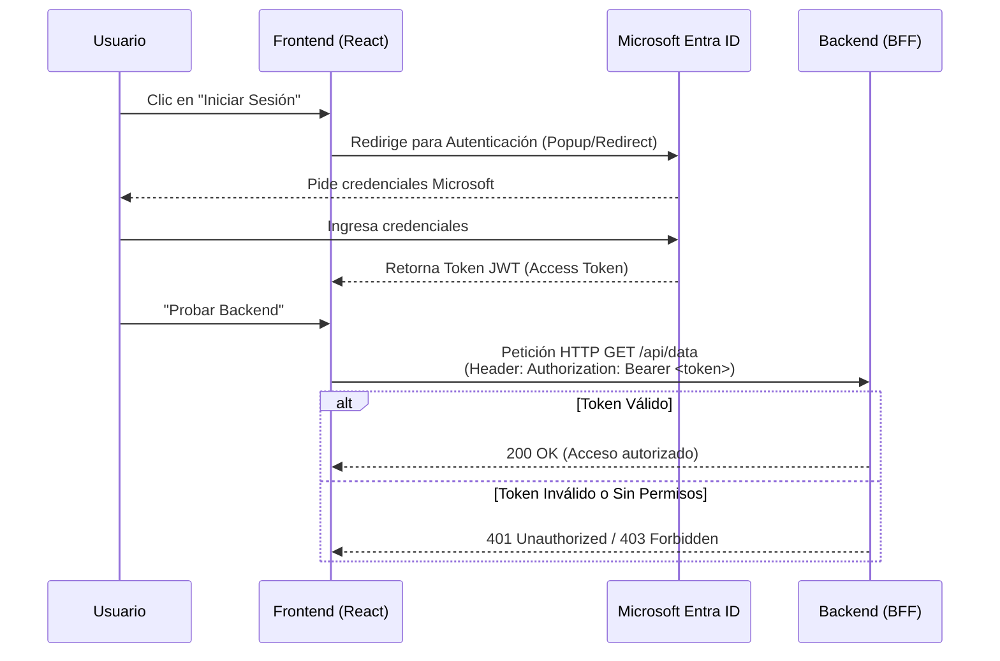

# Pedidos360 - Frontend 🌐🛒

Este repositorio contiene la aplicación Frontend para **Pedidos360**, diseñada para que una red de 20 PyMEs pueda interactuar con el sistema de pedidos de forma fácil y segura.

Actualmente, este proyecto se enfoca en establecer y probar la base de **Autenticación con Microsoft Entra ID** y la comunicación segura con el Backend (a través del **BFF** o API Gateway).

Está desarrollado con **React 19** y empaquetado con **Vite**.

---

## 🛠️ Tecnologías Utilizadas

- **React (v19):** Construcción de la interfaz de usuario.
- **Vite:** Herramienta de construcción y servidor de desarrollo ultrarrápido.
- **Microsoft Authentication Library (MSAL):** 
  - `@azure/msal-react` y `@azure/msal-browser` para manejar el flujo de inicio de sesión con Azure Entra ID.

---

## 🔐 ¿Cómo funciona la Autenticación?

El frontend no almacena contraseñas ni valida usuarios por sí mismo. Todo el proceso se delega a **Microsoft Entra ID**. Una vez que el usuario inicia sesión exitosamente, el frontend recibe un **Token JWT** que adjunta a todas las peticiones (en el header `Authorization`) dirigidas al backend.



---

## 🚀 Cómo levantar el proyecto localmente

### 1. Prerrequisitos
Asegúrate de tener instalado **Node.js** (recomendado v18 o superior).

### 2. Instalación de dependencias
Abre una terminal en la raíz del proyecto y ejecuta:
```bash
npm install
```

### 3. Configuración de Variables de Entorno
El proyecto utiliza variables de entorno para conectarse al tenant correcto de Azure y al BFF. 
Copia el archivo de ejemplo para crear tu configuración local:

```bash
cp .env.example .env.local
```
Si es necesario, edita `.env.local` para ajustar las URLs (por defecto apunta al BFF en `http://localhost:8085`, pero si tu Docker compose expone el BFF en el `8080`, deberás cambiarlo a `http://localhost:8080`).

### 4. Ejecución del Servidor de Desarrollo
```bash
npm run dev
```
La aplicación estará disponible en **`http://localhost:5173`**. 

> [!WARNING]
> El puerto **5173** es estricto (`strictPort: true` en Vite). Debe ser ese puerto específico porque está configurado en las *Redirect URIs* del registro de la aplicación en Azure Entra ID y en las reglas de CORS del Backend.

---

## 🧪 Vistas de la aplicación

La interfaz cambia según el rol que entrega Entra ID en el token (`roles`):

| Vista | Cliente (sin rol) | Admin / Operator | Auditor |
|---|---|---|---|
| **Inicio** | Pedido en curso con su avance, últimos pedidos y productos recomendados | Operación del día: ventas, pedidos por aceptar (aceptar/rechazar), ventas de 7 días, stock por reponer y pedidos por estado | Igual que Admin, sin acciones |
| **Pedidos** | Mis pedidos con detalle lateral (seguimiento, productos, notificaciones) y cancelación mientras está en Creado | Gestión con botón del siguiente estado (Aceptar → Preparar → Despachar → Entregar), cancelación, acciones masivas, exportar CSV y detalle con registro de auditoría | – |
| **Catálogo** | Tarjetas con foto, filtros por categoría, carrito con botones − / + y "Continuar" al nuevo pedido | (Admin) tabla con stock − / +, interruptor de activo, edición en panel lateral, alta y eliminación | Catálogo de solo lectura |
| **Reportería** | – | (Admin) ventas, ticket promedio, ventas por hora, más vendidos, tiempo de entrega y pedidos activos | – |
| **Auditoría** | – | (Admin) eventos por tipo, usuario y pedido, con el evento original | Igual que Admin |

Reportería y Auditoría dependen de Kafka. Si su servicio no responde (o tarda más de 12 s), la vista muestra **"no disponible"** con un botón para reintentar en vez de quedarse cargando.

Los montos se muestran en pesos chilenos sin decimales (`$1.800`).

### Fotos de productos

Las fotos están en `public/products/<sku>.jpg` (por ejemplo `pan-001.jpg`). Un producto nuevo sin foto muestra el color e ícono de su categoría. Para agregarle foto basta con dejar el archivo con su SKU en minúsculas y sumarlo a la lista `PHOTOS` de `src/lib/products.js`.

Créditos: las fotos de PAS-002, PAS-003, PAS-004 y PAS-005 fueron aportadas por el equipo; el resto proviene de Wikimedia Commons con licencias libres (autor y licencia en la página de cada archivo): Marraqueta paceña.jpg, Chilean bread (2).jpg, Pan Amasado.JPG, Cajón con dobladitas.jpg, Brown Bread and Irish Butter.JPG, Pan Batido en Viña del Mar.jpg, Empanada de pino.jpg, Sopaipillas chilenas.jpg, Kuchen de manzana.jpg, Alfajorartes.JPG, Berliner (pastry).jpg, Espresso Americano.jpeg, Cappuccino in original.jpg, Caffe Latte at Pulse Cafe.jpg, Mocha coffee.jpg, Cup of black tea.JPG, Club sandwich at Café Picnic.jpg, Sándwich Barros Luco - Fuente Mardoqueo - 01.jpg, Chacarero-Fuente-Mardoqueo.jpg, Chicken salad sandwich 01.jpg, Oranges and orange juice.jpg, Mote con huesillo.jpg, Water Bottle (51308317077).jpg y Drinking can ring-pull tab.jpg.

---

## 📂 Estructura Principal del Proyecto

- `src/auth/`: configuración de MSAL (`authConfig.js`) y lectura del token.
- `src/api/`: cliente HTTP (`http.js`, agrega el token y corta a los 12 s) y llamadas a pedidos, catálogo, reportería y auditoría.
- `src/hooks/`: `useRoles` (roles del token) y `useData` (catálogo y pedidos).
- `src/lib/`: formatos (CLP, fechas, estados), categorías/fotos del catálogo y el carrito.
- `src/components/`: `Layout` (menú lateral), vistas por módulo y sus piezas (`home/`, `orders/`, `catalog/`).
- `src/styles.css`: sistema visual (colores, tarjetas, tablas, botones).
- `public/products/`: fotos del catálogo.
- `vite.config.js`: puerto fijo `5173` y la entrada adicional `redirect.html` que usa MSAL.
